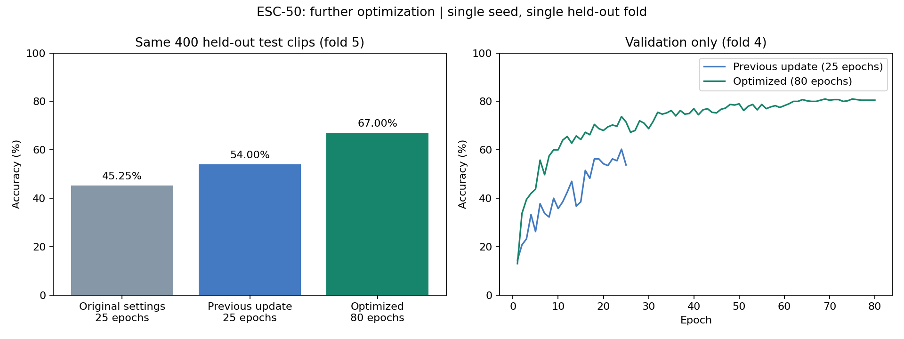

# Further ESC-50 optimization — 22 October 2026

## Changes

The baseline remains available with its original command-line defaults and checkpoint format.
The new `spectrogram` architecture uses eight small convolutions, batch normalization, feature dropout,
and temporal mean/max pooling while retaining four coarse frequency regions. Keeping frequency position
can help distinguish sounds that have similar overall energy but different spectral patterns.
The `highres` feature preset retains more audio bandwidth: 16 kHz sample rate, 64 mel bands,
FFT size 1,024, hop 320, and independent per-clip standardization.

Training-only augmentation randomly shifts each clip in time and masks short time/frequency regions.
Candidate B additionally uses mixup, blending features and the corresponding target losses.
Neither augmentation is applied during validation or testing, and cached features are never mutated.
The implementation is inspired by [SpecAugment](https://arxiv.org/abs/1904.08779)
and [mixup](https://arxiv.org/abs/1710.09412); this is not an exact reproduction of either paper's full experiment.

Both candidates train from scratch for 80 epochs with AdamW, cosine learning-rate decay,
learning rate 0.001, weight decay 0.0001, batch size 32, label smoothing 0.05, and seed 0.

| Candidate | Head dropout | Mixup alpha |
| --- | ---: | ---: |
| A | 0.4 | 0 (disabled) |
| B | 0.3 | 0.2 |

Training uses folds 1–3 (1,200 clips), model and candidate selection uses fold 4 (400 clips),
and only the selected candidate is evaluated on fold 5 (400 clips).
The selection script never reads test results. The two candidates were specified before either was tested.

## Run the search again

Choose a new output directory to preserve previous runs:

```powershell
.\.venv\Scripts\python optimize.py --output-dir outputs/optimization-new --evaluate-test
```

This runs both candidates, selects the highest validation accuracy, records `selection.json`,
and tests only the winner. Omit `--evaluate-test` to stop after validation selection.
`--reuse-completed` allows resuming only completed runs with matching settings and the same dataset path.
A partially completed candidate requires a new output directory.

To train one candidate directly:

```powershell
.\.venv\Scripts\python train.py --architecture spectrogram --feature-preset highres --epochs 80 --dropout 0.4 --weight-decay 0.0001 --optimizer adamw --scheduler cosine --augment --label-smoothing 0.05 --output-dir outputs/candidate-a-new
```

For candidate B, use `--dropout 0.3 --mixup 0.2` instead. All options and feature/model settings
are included in the saved checkpoint. `test.py` reconstructs the correct architecture automatically;
older baseline checkpoints still load.

Training accuracy for mixup is the blend-weighted proportion of predictions matching each constituent label.
With augmentation and smoothing, training loss/accuracy are not directly comparable to unaugmented validation scores.
All reported test scores use ordinary, unaugmented, unsmoothed cross-entropy and hard-label accuracy.

## Interpretation

These experiments change model capacity, preprocessing, regularization, and training duration together.
They do not isolate one technique's contribution or establish a five-fold benchmark.
The earlier baseline used 25 epochs; the new candidates use 80, with greater training compute.
Results remain a single seed and a previously used test fold, so confirmation on additional held-out folds
would be needed before making broader performance claims. No optimization setting is selected from fold-5 results.

## Completed results

| Measurement | Previous update | Candidate A (selected) | Candidate B |
| --- | ---: | ---: | ---: |
| Training epochs | 25 | 80 | 80 |
| Best validation accuracy | 60.25% | **81.00%** | 80.25% |
| Selected epoch | 24 | 69 | 73 |
| Test accuracy | 54.00% | **67.00%** | Not evaluated |
| Correct test clips | 216 / 400 | **268 / 400** | Not evaluated |
| Test loss | 1.682542 | **1.232913** | Not evaluated |
| Test macro F1 | 0.510740 | **0.654629** | Not evaluated |

Candidate A was frozen after validation selection and tested once in a fresh notebook kernel.
The improvement is **13 percentage points**, or **52 additional correct recordings**.
On the paired predictions, both models were correct on 189 clips; the optimized model alone was correct
on 79, the previous model alone on 27, and both were wrong on 105.
The optimized model therefore does not improve every individual prediction.
No candidate or hyperparameter was changed after viewing the final test score.

Training and testing ran locally on the RTX 4060 Laptop GPU, using Python 3.12.11 and
PyTorch/torchaudio 2.8.0+cu129. Six workflow checks passed. The optimized notebook completed without cell errors.
The candidate-selection record, both validation histories, and the selected model are versioned in `artifacts/`.
The model checkpoint is approximately 5.1 MB, so it is included directly in Git; the dataset and feature caches remain ignored.

## Use the published model

After following the environment and ESC-50 dataset setup in the README:

```powershell
.\.venv\Scripts\python test.py --checkpoint artifacts/optimized/audionet.ckpt --output-dir outputs/my-optimized-test
```

Or open `optimized_code_run.ipynb` with the repository environment. On this laptop its kernel is
**ESC-50 (new code)**. To register that name on another setup:

```powershell
.\.venv\Scripts\python -m ipykernel install --user --name reprodl2021-new-code --display-name "ESC-50 (new code)"
```

The notebook loads the included checkpoint and evaluates it; it does not repeat the 80-epoch training run.
Full training settings are recorded in `artifacts/optimized/run_config.json` and inside the checkpoint.
The timestamped original output paths are provenance only; test data is located by the current `--data-dir` option.
Checkpoint SHA-256: `2c97292a6aa16a5b1179bfa9d5fda55849f8b783274dc4de2461622cb2f46b9d`.


